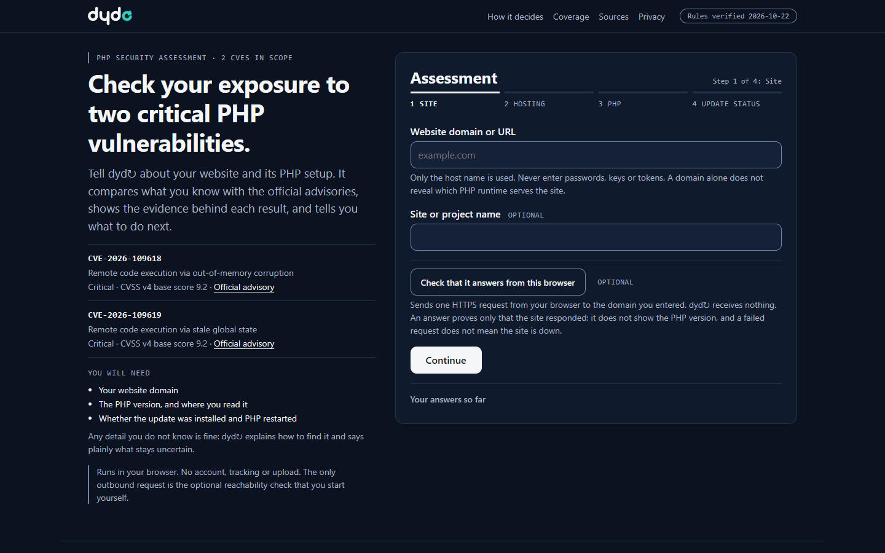
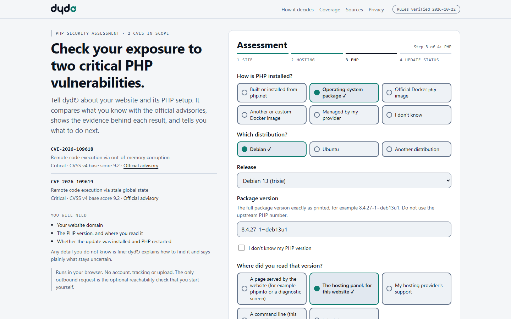
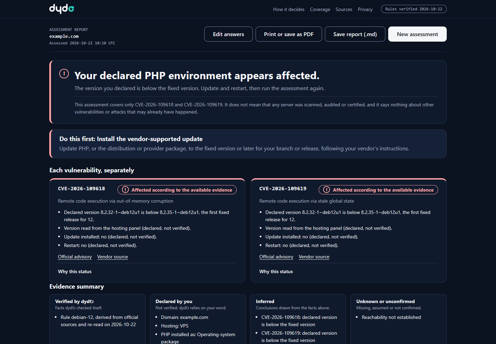
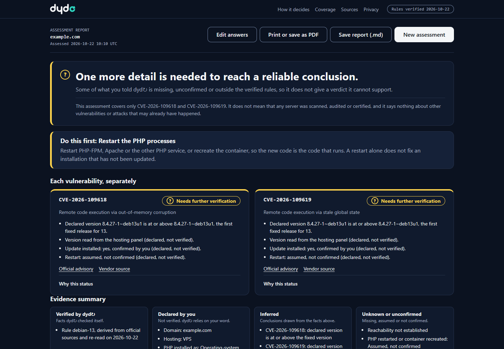
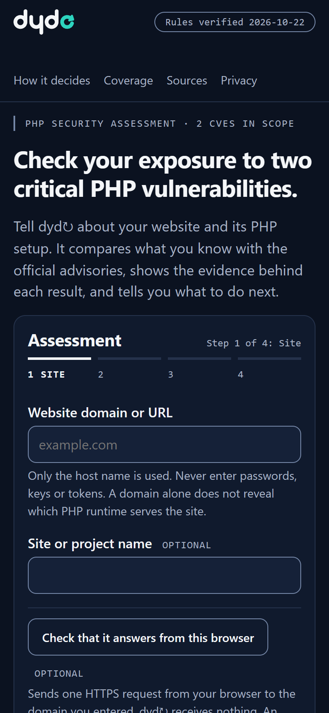

<p align="center">
  <picture>
    <source media="(prefers-color-scheme: dark)" srcset="BRAND/dyd-brand/svg/dyd-logo-primary-dark.svg">
    
  </picture>
</p>

# dyd↻

**dyd↻** is a free, open-source, purely static web page that guides a website owner through an evidence-based check of their declared PHP environment against exactly two vulnerabilities: [CVE-2026-109618](https://github.com/php/php-src/security/advisories/GHSA-w8hw-w9fx-j79w) (remote code execution via out-of-memory corruption) and [CVE-2026-109619](https://github.com/php/php-src/security/advisories/GHSA-6wmf-4rv5-p3rp) (remote code execution via stale global state). There is no backend, account, analytics, cookie, browser storage or upload. The interface is in English.

> dyd↻ is an independent project and is not affiliated with or endorsed by the PHP Group, Debian, Ubuntu, Docker or Plesk. The name "dyd" has not undergone trademark or domain clearance (see `BRAND/BRAND.md`, section 8).

Tool: <https://cvechecker26.github.io/dyd/>



## What dyd↻ does

1. **Site**: you enter the domain (only the host name is kept) and, optionally, press a button that checks whether the site answers over HTTPS from your browser.
2. **Hosting**: shared, managed, VPS, dedicated, cloud, Docker or other; provider and control panel are optional.
3. **PHP**: how PHP is installed (php.net build, Debian or Ubuntu package, official Docker image, Plesk, provider-managed), the version, and where you read it. "I don't know my PHP version" shows instructions tailored to your panel and install type.
4. **Update status**: whether the update was installed, where it came from, and whether PHP was restarted (each as confirmed, assumed, no or unknown).

The report shows an overall headline, **each CVE separately** with its status, evidence and official advisory, an evidence summary (verified by dyd↻, declared by you, inferred, unknown), a prioritized action plan, an explanation of the vulnerabilities taken from the advisories, and the provenance (when it was assessed, which rules, which sources). You can print it or save it as a Markdown file; both happen in your browser and nothing is uploaded.

## What it cannot determine

A web page cannot read a remote server's PHP runtime, packages or processes, and browser rules hide response headers from other sites. A domain alone therefore does not reveal the PHP version, and dyd↻ never infers one from a CMS, a header or the domain. Everything about PHP is **declared by you** and labelled that way. The reachability check only shows that some HTTP response arrived; a failed request is "inconclusive", never "down", "vulnerable" or "fine". dyd↻ never claims or implies that a server was scanned, audited or certified.

## Facts from the PHP announcement

dyd↻ reads the [PHP security announcement](https://www.php.net/archive/2026.php#2026-10-21-5) for the fixed versions, which installations serve web requests (PHP-FPM, Apache mod_php, php-cgi, FrankenPHP, LiteSpeed; the risk is highest for mod_php), the end of updates for PHP 8.1 and older, and the temporary mitigations with their limitations. The announcement does not list affected versions; those thresholds come from the two advisories. For PHP 7.4, 8.0 and 8.1, which only have minimal source backports on GitHub branches and no new versions, a version number proves nothing, so the result is always "Needs further verification" with a note and links. PHP 8.6 is a pre-release (needs verification); 8.6.0 RC4 contains the fixes according to the php-src NEWS file. The question "How does the web server run PHP?" is optional, never changes the result and shows no score. Mitigations are summarised with their limitations, never change the result, and are not a replacement for updating: a restart alone does not fix an installation that has not been updated.

## Statuses

| Status | Meaning |
|---|---|
| Affected according to the available evidence | The declared version is below the fixed version, it is declared to describe the PHP serving the site, and nothing contradicts it. A restart does not change this. |
| Remediation supported by the available evidence | At or above the fixed version, from the serving PHP, with a confirmed update, a confirmed restart, and no other PHP runtime in doubt. Only these two CVEs, only the declared evidence. |
| Needs further verification | Something is missing, assumed, contradictory, a version read only from a command line, provider-managed, or outside the verified rules. |

How the result is calculated, in order, is in [METHODOLOGY.md](METHODOLOGY.md). Rules exist for php.net 8.2–8.5, the official Docker `php` image 8.2–8.5, Plesk on Linux 8.2–8.5, Debian 12 and 13, and Ubuntu 26.10 down to 14.04 (Pro/ESM for the oldest). Provider-managed PHP, cPanel/EasyApache, CloudLinux, PHP 8.1 and older, pre-releases and other platforms always resolve to "Needs further verification".

## Finding the missing details

Hosting panel (cPanel: MultiPHP Manager; Plesk: Websites & Domains → PHP Settings), a phpinfo page that only administrators can open (delete it afterwards), your provider's support, or a command: `php-fpm -v`, `docker exec CONTAINER php -v`, `dpkg-query -W -f='${Version}\n' php8.4-fpm`. A command-line `php -v` can differ from the PHP that serves the site. The page shows the right instructions when you tick "I don't know my PHP version".

| Light theme, PHP step | Result: affected | Result: needs verification | Mobile |
|---|---|---|---|
|  |  |  |  |

(The screenshots were captured by Playwright from the real page.)

## Run locally

Open `index.html` directly in a browser, or serve the folder (`python -m http.server 8080` or `npx serve`). All URLs are relative, so the site also works under a repository subpath such as `/dyd/`.

## Tests

```
npm install
npm test          # rules, engine, assessment, copy, static, contrast, docs and workflow checks (no dependencies needed)
npm run test:e2e  # browser tests with an installed Edge or Chrome (needs the dev dependencies)
npm run screenshots
npm run check:live   # checks the published page
```

`npm test` uses Node's built-in test runner only. The end-to-end tests use `playwright-core` and `@axe-core/playwright` (dev dependencies; no browser is downloaded).

## Update the rules

`rules.json` is the single source of truth. After editing it, run `node scripts/build-rules.js`; a test fails if `rules.js` is not exactly what the script produces. Only add or change a rule from sources you have read, record the URLs and the day, and update the verification log in [METHODOLOGY.md](METHODOLOGY.md).

## Contributing

Issues and pull requests are welcome, especially corrections to rules with a primary source attached. Keep the scope: these two advisories, no scanning, no backend, no new runtime dependencies, English only.

## Rules status

Rules last verified: 2026-10-22 (AI-assisted reading of official sources). **Independent human review is pending.**

## Documents

[METHODOLOGY](METHODOLOGY.md) · [PRIVACY](PRIVACY.md) · [SECURITY](SECURITY.md) · [CHANGELOG](CHANGELOG.md) · [LICENSE](LICENSE) (MIT)

Advisories: [GHSA-w8hw-w9fx-j79w](https://github.com/php/php-src/security/advisories/GHSA-w8hw-w9fx-j79w) · [GHSA-6wmf-4rv5-p3rp](https://github.com/php/php-src/security/advisories/GHSA-6wmf-4rv5-p3rp)

## Suggested repository settings

Description: "Guided, evidence-based check of a declared PHP environment against CVE-2026-109618 and CVE-2026-109619. Runs in your browser." Topics: `php`, `cve`, `security`, `static-site`, `github-pages`, `privacy`.
